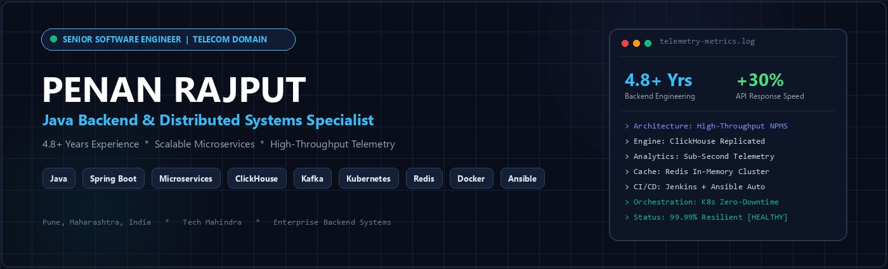

<h1 align="center">Hi 👋, I'm Penan Rajput</h1>
<h3 align="center">Senior Software Engineer | Java Backend & Distributed Systems Specialist</h3>

  
  
  
  
  
  
  

---

### 👨‍💻 About Me

Experienced **Senior Java Backend Developer** with **4.8+ years of experience** architecting, developing, and deploying scalable, high-throughput backend systems in the **Telecom domain**. 

- 💼 **Current Role:** Senior Software Engineer at **Tech Mahindra** (Pune, Maharashtra).
- ⚙️ **Core Specialization:** Java, Spring Boot, Microservices Architecture, and Distributed Systems.
- 🚀 **High-Throughput & Telemetry:** Hands-on expertise building NPMS backend architectures with **ClickHouse** (`ReplicatedMergeTree` & `Distributed` table engines), processing high-velocity network telemetry with sub-second queries.
- ⚡ **Performance Optimization:** Successfully boosted API response times by **30%** using **Redis caching**, query optimization, and system tuning.
- ☁️ **DevOps & Observability:** Strong proficiency in **Docker, Kubernetes, Jenkins, Ansible, Kafka, Prometheus, and Grafana**.
- 🤖 **GenAI & Tooling:** Leveraging Agentic IDEs (**Kiro IDE**) and AI assistants (**Amazon Q**) for accelerated, reliable development.

---

### 🛠️ Technical Arsenal

| Category | Technologies & Tools |
| :--- | :--- |
| **Languages** |    |
| **Backend Frameworks** |      |
| **Architecture & Design** | `Microservices` `Saga Design Pattern` `SOLID Principles` `Multithreading` `High-Throughput Architecture` `Distributed Systems` |
| **Databases & Caching** |         |
| **Messaging & Streaming** |  |
| **Cloud & DevOps** |        |
| **Observability & Monitoring** |    |
| **Testing & Build** |      |
| **Workflow & AI Tools** |   `Kiro IDE` `Amazon Q` |

---

### 💼 Professional Experience

#### **Tech Mahindra** | *Pune, Maharashtra*
**Associate Software Engineer → Software Engineer → Senior Software Engineer**  
*Mar 2022 – Present*

- **Microservices & API Engineering:** Designed and implemented scalable microservices and high-performance RESTful APIs using Java and Spring Boot for mission-critical enterprise telecom infrastructure.
- **High-Throughput NPMS Architecture:** Contributed to backend architecture for a high-throughput Network Performance Management System (NPMS) facilitating automated network traffic analysis and anomaly detection.
- **Big Data & Telemetry with ClickHouse:** Designed optimized ClickHouse schemas leveraging `ReplicatedMergeTree` and `Distributed` table engines to power high-throughput network telemetry ingestion and sub-second analytical queries.
- **Performance Optimization:** Integrated **Redis caching** and performed deep query tuning and thread management, improving API response times by **30%**.
- **Containerization & Orchestration:** Containerized distributed services using **Docker** and deployed on **Kubernetes (K8s)**, ensuring fault tolerance, zero-downtime rolling deployments, and horizontal auto-scaling.
- **CI/CD & Governance:** Automated end-to-end build, test, and deployment workflows using **Jenkins** and **Ansible**. Enforced container governance via **Harbor** and managed artifact versioning through **Nexus**.
- **Observability:** Built custom **Grafana** dashboards and integrated real-time telemetry monitoring for end-to-end system health and performance observability.
- **Enterprise Module Development:** Developed and maintained core backend modules utilizing **Spring Boot, Core Java, Microservices, PostgreSQL, HBase, and Hibernate**.
- **Order & Inventory APIs:** Implemented robust, secure APIs for enterprise-grade order tracking and real-time inventory management.
- **Agile & Quality Assurance:** Collaborated closely in Agile ceremonies, leading UAT defect resolution, test-case authoring, and sprint planning.
- **Stakeholder Collaboration:** Commended for clear stakeholder communication and reliable delivery of high-quality software.

---

### 🏆 Honors & Awards

| Award | Organization | Date |
| :--- | :--- | :--- |
| 🌟 **Standing Ovation Award** | Tech Mahindra | Sep 2026 |
| 🌟 **Standing Ovation Award** | Tech Mahindra | Jun 2026 |
| 🌟 **Standing Ovation Award** | Tech Mahindra | Nov 2025 |
| 🌟 **Standing Ovation Award** | Tech Mahindra | May 2025 |
| 👏 **Pat On Back Award** | Tech Mahindra | Mar 2025 |

---

### 🎓 Education

- **Bachelor of Technology (B.Tech.) in Computer Science & Engineering**  
  *Dr. Babasaheb Ambedkar Technological University, Maharashtra, India*  
  *Aug 2017 – Jul 2021*

---

### 📊 GitHub Activity & Statistics

  
  

  

---

  <i>⭐️ From <a href="https://github.com/penanrajput">penanrajput</a> | Let's connect and build something extraordinary!</i>

